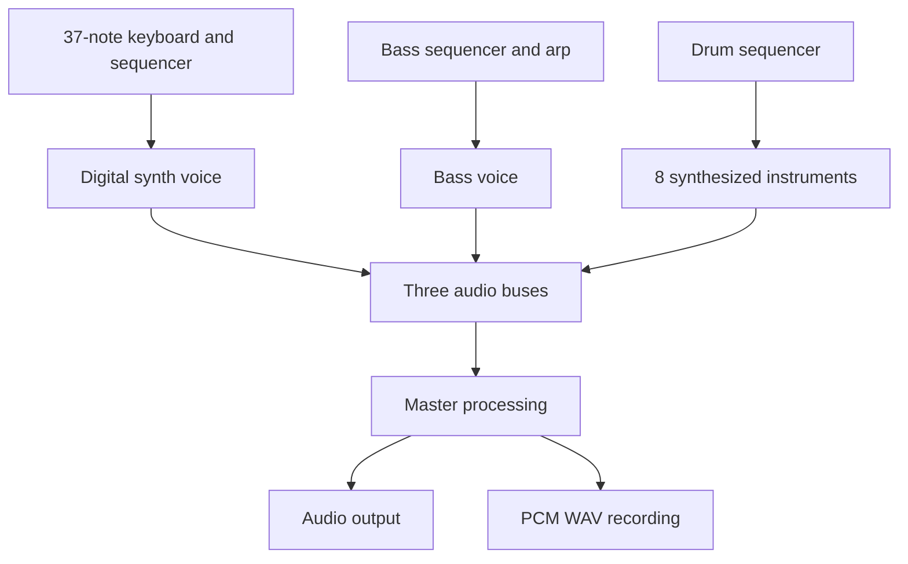

# NIKO ANALOG 37 — Studio Niko Design

**Browser-native synthesizer · Techno groovebox · Web Audio**

 

> **Identité du dépôt : N8V est le nom historique, pas un codec vidéo 8K actuel.** La branche main contient le synthétiseur NIKO ANALOG 37. Ce dépôt doit être classé dans les projets audio.

[Application (URL GitHub Pages indicative)](https://nikoju1977.github.io/N8V/) · [English overview](#english-overview) · [Portfolio](https://github.com/Nikoju1977)

**STUDIO NIKO DESIGN** · Build smart. Stay lightweight. Create without limits.

> [Insérer ici un GIF de démonstration / Insert demo GIF here]

## Pourquoi ce projet ?

Créer un instrument techno autonome, à faible complexité d'installation, avec un moteur Web Audio réellement exécutable. N8V reste le nom du dépôt historique ; la branche principale inspectée ne contient pas le moteur vidéo 8K anciennement associé à ce nom.

## DSP et formats — inspection des sources

| Fonction dans [index.html](index.html) | Implémentation |
| --- | --- |
| `playSynth`, `scheduleADSR` | Oscillateurs numériques, filtrage passe-bas, enveloppes d'amplitude et de filtre, modulation et saturation. |
| `drumVoice` | Percussions générées à partir d'oscillateurs et bruit filtré ; aucun échantillonneur externe requis pour ces voix. |
| `scheduler`, `scheduleStep` | Horloge AudioContext, anticipation de 130 ms et swing ; séquences pilotées au seizième de note. |
| `waveShape`, `makeImpulse` | Courbe de saturation tanh et réponse impulsionnelle stéréo générée par bruit décroissant. |
| `startRecording`, `encodeWav` | Capture master avec ScriptProcessorNode (2048 trames) et construction RIFF/WAVE PCM 16 bits stéréo à la fréquence réelle du contexte. |
| `snapshot`, `restore` | Presets et séquences JSON. |
| `connectMIDI` | Entrée Web MIDI si le navigateur le permet. |

### Performances et limites

Le moteur ne nécessite pas de codec vidéo ni de bibliothèque DSP externe pour les fonctions audio inspectées. Le scheduler à anticipation n'est pas une garantie de latence ou de stabilité. ScriptProcessorNode est une API dépréciée, sensible à la charge du thread principal ; les buffers de capture consomment de la mémoire. Aucun débit audio, nombre de voix maximal stable, mesure de jitter, THD ou benchmark comparatif n'a été exécuté ici. Le WAV n'est pas un fichier 8K vidéo. Les résultats de tests historiques ne valent pas validation de cette révision.

Les presets et séquences sont sauvegardés en clair dans le stockage navigateur ; les permissions Web MIDI et le cache PWA dépendent de la plateforme. Ne pas assimiler l'inspiration analogique à une émulation circuit par circuit, ni à une affiliation Moog.

## Architecture audio

| Source | Responsabilité |
| --- | --- |
| [index.html](index.html) | Interface, transport, synthèse, mixage, capture et presets |
| [manifest.webmanifest](manifest.webmanifest) | Métadonnées PWA |
| [service-worker.js](service-worker.js) | Service worker |

Le code inspecté crée de vrais oscillateurs Web Audio, enveloppes et générateurs de bruit. L'inspiration analogique décrit une architecture musicale, pas une reproduction physique certifiée d'un synthétiseur commercial.

**Synthétiseur virtuel et station de production techno (v1.1).**

> Le dépôt conserve son nom historique **N8V**, mais son contenu sur la branche **main** est maintenant l'application NIKO ANALOG 37. L'ancien projet expérimental de codec n'est plus dans les fichiers actuels de cette branche ; l'historique Git reste conservé.

## Quickstart / Démarrage rapide

Ouvrir `index.html` dans Chrome, Edge ou Firefox, ou publier le dossier sur un hébergement statique HTTPS (GitHub Pages, Vercel, etc.). Sur Android, le navigateur doit permettre l'activation audio après une interaction utilisateur.

## Modules

- Synthèse numérique Web Audio inspirée de l'architecture d'un synthétiseur analogique : deux oscillateurs, sub-oscillateur, bruit, filtre résonant, enveloppes, LFO et saturation.
- Clavier virtuel 37 notes, contrôle tactile et clavier d'ordinateur.
- Arpégiateur principal et séquenceur mélodique de 64 pas.
- Boîte à rythmes 8 instruments × 16 pas : kick, snare, clap, hats, tom, rim et ride.
- **DRUMS ONLY** pour jouer la batterie seule ; **TEST 8 SONS** pour vérifier les pistes ; **RESET BATTERIE** pour restaurer un rythme.
- Basse indépendante avec séquenceur et deuxième arpégiateur.
- Mixeur trois bus, filtres, égalisation 3 bandes et effets.
- Enregistrement du mix et export WAV stéréo 16 bits ; import/export de presets JSON.

## Démarrage et dépannage audio

1. Cliquer sur **ACTIVER AUDIO**.
2. Pour contrôler la batterie, cliquer sur **TEST 8 SONS**, puis **DRUMS ONLY**.
3. Si le son est absent, cliquer sur **RESET BATTERIE**, vérifier le volume du bus batterie, le volume média et la sortie Bluetooth/casque.
4. Pour jouer tous les instruments, utiliser **PLAY**.
5. Cliquer sur **REC WAV**, puis sur **FIN REC** pour télécharger le mix.

Sur mobile, éviter les prévisualiseurs de fichiers qui bloquent parfois Web Audio. Préférer l'ouverture depuis un site HTTPS.

## Installation PWA

L'application contient `manifest.webmanifest`, `service-worker.js` et des icônes. Elle peut être servie depuis un site HTTPS. Une fois GitHub Pages activé pour la branche **main** et le dossier **/**, la page devrait être accessible à l'adresse `https://nikoju1977.github.io/N8V/`, sous réserve du déploiement. L'installation dépend du navigateur et de son support PWA.

## Portée des tests

La version v1.1 a été testée dans Chromium pour la lecture, la séquence de batterie, les tests des 8 instruments et la production d'un WAV non silencieux. **Aucune validation sur le téléphone réel de l'utilisateur n'est revendiquée.**

## Attribution

Création : **Studio Niko**. Projet indépendant, non affilié à Moog Music. Inspiré par l'ergonomie et l'architecture de synthétiseurs analogiques, **sans reproduction identique des circuits analogiques ni du produit commercial Moog Subsequent 37**.

## Code source

https://github.com/Nikoju1977/N8V

## Contrôle reproductible proposé

Activer le son, essayer les huit percussions, puis jouer le clavier et la basse. Enregistrer un court WAV, vérifier son en-tête, ses canaux et sa lecture. Exporter puis restaurer un preset JSON. Consigner le commit, le navigateur et les éventuels décrochages audio. Les essais historiques décrits plus haut ne sont pas une validation de cette révision : aucun nouveau test audio n'a été lancé.

## Roadmap & contribution

Propositions non terminées :

- [ ] Remplacer la capture ScriptProcessorNode par AudioWorklet avec tests de non-régression.
- [ ] Mesurer jitter, latence, charge CPU et décrochages sur appareils modestes.
- [ ] Vérifier le WAV (en-tête, canaux, fréquence, durée, niveau non nul) et les presets sur plusieurs navigateurs.
- [ ] Documenter les limites Web MIDI et PWA ; conserver le codec historique dans un projet distinct uniquement si son code est retrouvé et qualifié.

**Première contribution / `good first issue` (label proposé, non créé ici) :** Proposer un test synthétique de lecture WAV et restauration JSON sans données privées.

[Issues](https://github.com/Nikoju1977/N8V/issues) : retours reproductibles bienvenus dans le cadre des droits existants. Ne pas publier de clés, médias privés ou documents confidentiels.

## English overview

N8V currently hosts NIKO ANALOG 37, a browser-native digital synth and groovebox, not an 8K video codec. The engine uses Web Audio oscillators, filtered noise, envelope scheduling, three buses, MIDI input when supported and PCM WAV capture via deprecated ScriptProcessorNode. No new audio performance or hardware tests were run.

NIKO ANALOG 37 is a browser-based digital synthesizer and techno groovebox with a 37-note keyboard, melodic sequencing, arpeggiation, eight drum voices, an independent bass and a three-bus mixer. The current N8V repository is an audio application, not an 8K video codec. It includes PCM WAV recording and JSON presets. Browser and mobile audio reliability must be verified separately. No fresh runtime or deployment check was performed for this documentation update.

## Licence / License

[LICENSE.md](LICENSE.md) preserves existing rights for original Studio Niko Design contributions; publication alone is not an open-source license. Third-party rights remain unaffected. Reproducible issue reports are welcome subject to these terms.

**Studio Niko Design** · Browser-native music production.
